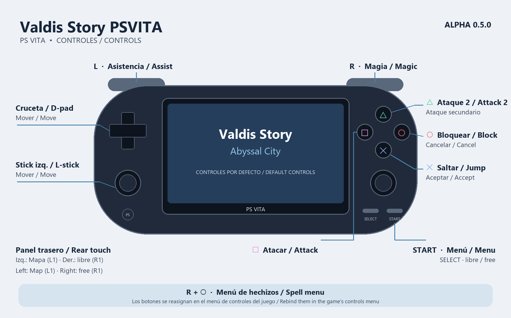

# Valdis Story PSVITA

**ULTRA IA VIBECODED!** · 100 % hecho con IA / 100 % AI-made

[Español](#español) · [English](#english)



---

## Español

Port nativo de **Valdis Story: Abyssal City** para PlayStation Vita. Es un *runner* propio de GameMaker Studio 1.x escrito en C++17 desde cero: máquina virtual, eventos, salas, dibujo, partículas y audio. No es un emulador ni usa YoYo Loader. El juego se convierte a partir de **tu propia copia de Steam** directamente en la consola.

**Versión 0.5.0-alpha** · Title ID `VALDIS001` · Estado: jugable, en pruebas. Ver [estado y roadmap](docs/ROADMAP.md).

### 🤖 Proyecto 100 % "vibecoded"

**Todo el código, las herramientas, las pruebas y la documentación de este repositorio los escribió una IA.** Ninguna línea se escribió a mano. El usuario dirigió el proyecto, probó cada build en una PS Vita real y dio feedback. La IA analizó el juego, escribió el runner, lo depuró con los registros y capturas de la consola y midió el rendimiento.

| Modelo de IA | Uso |
|---|---|
| **Claude Opus 5.5** (Anthropic) | Modelo principal: diseño, todo el código del runner, el traductor AOT, depuración en la Vita, optimización y documentación |
| **Claude Sonnet 5.5** (Anthropic) | Subagentes: búsquedas en el código, revisiones y tareas en paralelo |

Herramienta: **Claude Code** (app de escritorio). Que sea código generado por IA significa que puede tener errores que nadie ha revisado línea a línea: repórtalos en *Issues*.

### ⚠️ Aviso legal

- **Este proyecto NO apoya, promueve ni facilita la piratería.** Necesitas tu **propia copia legal de Valdis Story: Abyssal City comprada en Steam**. Aquí no hay enlaces a copias no autorizadas; no pidas ni compartas archivos del juego en este repositorio.
- El repositorio y el VPK de Releases **no incluyen el juego**: ni código, ni gráficos, ni música, ni textos, ni el `.exe`. El VPK solo trae el motor y no funciona por sí solo. En el primer arranque, la consola convierte los archivos de tu copia.
- La versión rápida (AOT) lleva código traducido de tu copia: **es solo para uso personal** y no se puede compartir.
- Valdis Story: Abyssal City es propiedad de **Endless Fluff Games**. Este es un proyecto de fans sin ánimo de lucro, sin relación con Endless Fluff Games, Valve ni Sony. Tener una copia no da permiso para redistribuir sus archivos.

### Versión de Steam necesaria

| | |
|---|---|
| Juego | **Valdis Story: Abyssal City** (Steam, App ID **252030**) |
| Build probada | **722041** (la versión actual de Steam) |
| `data.win` | 259 836 864 bytes · SHA-256 `0a9c913393a30039f696df796d94f0b290c2871febb44a58ad9178f5647d010f` |

Compruébalo en PowerShell **antes de copiarlo**:

```powershell
Get-FileHash "C:\Program Files (x86)\Steam\steamapps\common\ValdisStoryAbyssalCity\data.win" -Algorithm SHA256
```

Otras builds (o versiones de otras tiendas) pueden funcionar, pero no están probadas. No uses un `data.win` modificado.

### Dos versiones

| | VPK de Releases (intérprete) | Versión compilada (AOT) |
|---|---|---|
| Contenido | Solo el motor | Motor + código del juego traducido a C++ |
| Velocidad | Más lenta en salas cargadas | 60 fps en casi todo el juego (ver roadmap) |
| Cómo conseguirla | Descargar de [Releases](../../releases) | Compilarla tú desde tu copia (ver [Compilar](#compilar)). **No se puede compartir** |

### Requisitos

- PS Vita o PS TV con **HENkaku / h-encore / Enso** y **VitaShell**.
- **`ur0:data/libshacccg.suprx`** (compilador de shaders de vitaGL), extraído con **ShaRKBR33D** en la propia consola.
- No hace falta ningún plugin de taiHEN. Recomendado: el 4.º núcleo libre con **CapUnlocker**.
- Espacio libre en `ux0:` para la copia del juego (~400 MB) más unos **300 MB** de datos convertidos.
- Relojes: el port funciona con los de serie (CPU 500 MHz / GPU 222 MHz). Si subes los relojes con un plugin, lo haces tú y bajo tu responsabilidad: más calor y más desgaste de la batería.

### Instalación

1. Descarga `vsvita.vpk` de [Releases](../../releases) e instálalo con VitaShell.
2. Copia de tu carpeta de Steam `steamapps/common/ValdisStoryAbyssalCity/` a `ux0:data/valdis/game/`: `data.win`, las carpetas `data_1`, `data_2`, `data_5` y todos los `music_*.ogg`. El `.exe` y las `.dll` no hacen falta.
3. Abre el juego. El primer arranque convierte los datos (unos minutos, con barra de progreso). Las partidas se guardan en `ux0:data/valdis/save/`.

### Controles

Son los controles por defecto del juego con mando; se pueden reasignar en el menú de controles del propio juego.

| Vita | Acción |
|---|---|
| Cruceta / stick izquierdo | Moverse y navegar menús |
| ✕ | Saltar / aceptar |
| ○ | Bloquear / cancelar |
| □ | Atacar |
| △ | Ataque 2 |
| R | Magia |
| L | Asistencia |
| R + ○ | Menú de hechizos |
| Panel trasero izquierdo / derecho | Mapa (L1) / libre (R1) |
| START / SELECT | Menú / libre |

La imagen se genera con `python -I tools/make_controls.py`.

### Compilar

Requisitos: CMake 3.16+, [VitaSDK](https://vitasdk.org), y para PC MSYS2 (SDL2, zlib, libvorbis).

```bash
# Herramientas y runner de PC
cmake -S runner -B build/pc -G Ninja && cmake --build build/pc
# VPK sin código del juego (el de Releases)
cmake -S runner -B build/vita_noaot -G Ninja -DCMAKE_TOOLCHAIN_FILE=$VITASDK/share/vita.toolchain.cmake -DVS_AOT=OFF
cmake --build build/vita_noaot
```

Versión rápida (AOT) desde tu copia: `build/pc/vsconv` genera `game.vsd` desde tu `data.win`, `build/pc/vsaot` lo traduce a C++ en `build/aot_gen/`, y la build de Vita normal (`-DVS_AOT=ON`) lo incluye. Detalles en [runner/README.md](runner/README.md).

### Créditos

- Juego original: **Endless Fluff Games**.
- [VitaSDK](https://vitasdk.org), [vitaGL](https://github.com/Rinnegatamante/vitaGL) (Rinnegatamante), [stb_image](https://github.com/nothings/stb) (dominio público).
- Análisis local del juego con [UndertaleModTool](https://github.com/UnderminersTeam/UndertaleModTool) (no se incluye nada de lo extraído).
- CapUnlocker, ShaRKBR33D y VitaShell, de sus respectivos autores.

### Documentación

- [Roadmap, estado y medidas en la consola](docs/ROADMAP.md)
- [Herramientas de prueba (futuro menú de trucos)](docs/TESTING.md)
- [Datos y conversión](docs/DATA.md)
- [Arquitectura del runner](runner/README.md)
- [Viabilidad inicial](docs/VIABILIDAD.md) · [Notas de decompilación](docs/NOTAS_DECOMP.md)
- [Traspaso completo del proyecto (todo lo visto, reglas y roadmap)](docs/TRASPASO.md)
- [Montar el entorno en un PC nuevo](docs/INSTALAR_PC_NUEVO.md)
- [Guía base para publicar cualquier port](docs/ESTRUCTURA_REPOS.md) · [Cómo publicar este](docs/PUBLICAR.md) · [Icono y LiveArea](docs/LIVEAREA.md)

---

## English

**ULTRA AI VIBECODED!** Native port of **Valdis Story: Abyssal City** to PlayStation Vita: a custom GameMaker Studio 1.x runner written from scratch in C++17 (VM, events, rooms, rendering, particles, audio). It is not an emulator and does not use YoYo Loader. The game is converted from **your own Steam copy** on the console itself.

**Version 0.5.0-alpha** · Title ID `VALDIS001` · Status: playable, under testing. See the [roadmap](docs/ROADMAP.md) (Spanish).

### 🤖 100 % vibecoded

**All the code, tools, tests and documentation in this repository were written by AI**; no line was written by hand. The user directed the project, tested every build on a real PS Vita and gave feedback.

| AI model | Role |
|---|---|
| **Claude Opus 5.5** (Anthropic) | Main model: design, all runner code, the AOT translator, on-console debugging, optimisation and docs |
| **Claude Sonnet 5.5** (Anthropic) | Sub-agents: code searches, reviews and parallel tasks |

Tool: **Claude Code** (desktop app). AI-generated code may contain bugs nobody reviewed line by line: please report them in *Issues*.

### ⚠️ Legal notice

- **This project does NOT condone, promote or facilitate piracy.** You need your **own legal Steam copy of Valdis Story: Abyssal City**. No links to unauthorised copies are provided; do not request or share game files here.
- The repository and the Releases VPK **do not include the game** (no code, graphics, music, text or `.exe`). The VPK only contains the engine and cannot run by itself.
- The fast AOT build contains code translated from your copy: **personal use only**, never share it.
- Valdis Story: Abyssal City belongs to **Endless Fluff Games**. Non-profit fan project, not affiliated with Endless Fluff Games, Valve or Sony.

### Required Steam version

Steam App ID **252030**, build **722041** (current). `data.win`: 259,836,864 bytes, SHA-256 `0a9c913393a30039f696df796d94f0b290c2871febb44a58ad9178f5647d010f` (check it with `Get-FileHash ... -Algorithm SHA256`). Other builds are untested.

### Two builds

The VPK on [Releases](../../releases) is the **interpreter** build (engine only, shareable, slower in heavy rooms). The fast **AOT** build translates the game's code to C++ and must be **built by yourself** from your own copy; it cannot be shared.

### Installation

1. Install `vsvita.vpk` from [Releases](../../releases) with VitaShell. Requires `ur0:data/libshacccg.suprx` (extract it with ShaRKBR33D).
2. Copy `data.win`, `data_1/`, `data_2/`, `data_5/` and every `music_*.ogg` from `steamapps/common/ValdisStoryAbyssalCity/` into `ux0:data/valdis/game/`.
3. Launch the game. The first boot converts the data (a few minutes, with a progress bar).

Runs at stock clocks (500/222 MHz). Overclocking is your own choice and risk (heat and battery wear).

### Controls

See the image above: ✕ jump/accept, ○ block/cancel, □ attack, △ attack 2, R magic, L assist, R + ○ spell menu, rear touch left = map, START menu. Rebind them in the game's controls menu.

### Building

See the Spanish section above (`cmake` commands) and [runner/README.md](runner/README.md).
